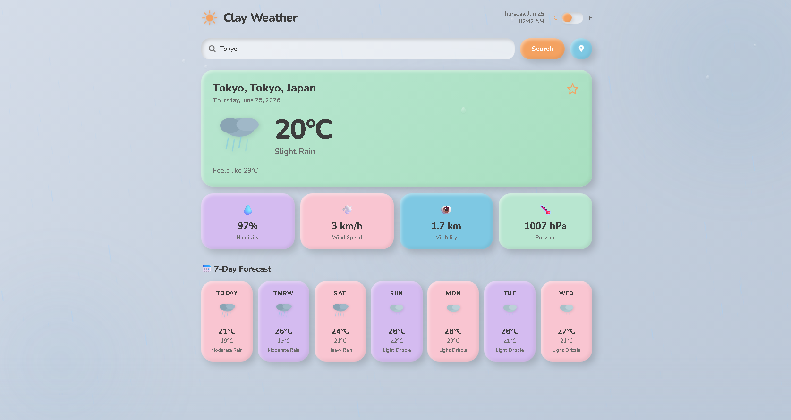

# Clay Weather — Playful Weather Web Application

A modern, fully responsive weather forecasting web application featuring a premium **Claymorphism** design language and dynamic, performance-optimized background weather animations. Built using vanilla HTML, CSS, and modern modular JavaScript, it integrates with the Open-Meteo API.

🚀 **[Review Website](https://clay-weather.netlify.app/)**

---

## 🌟 Features

* **City Search**: Search for real-time weather in any city globally using the Open-Meteo Geocoding API.
* **Geolocation Detection**: Instantly detect and load the weather for your current location with reverse geocoding fallback.
* **Real-time Weather Metrics**:
  * Current temperature and feels-like temperature.
  * Description of conditions and animated SVG weather icon.
  * Wind speed, humidity percentage, atmospheric pressure, and visibility range.
* **7-Day Forecast**: Display of forecast cards with min/max temperatures and icons.
* **Favorites Manager**: Save and manage a list of favorite cities stored locally in the browser (`localStorage`).
* **Unit Toggle**: Instantly switch between Celsius (°C) and Fahrenheit (°F) with local persistence.
* **Claymorphic UI**: Playful design using soft 3D-like shadows, rounded borders, pastel palettes, and interactive clay-press states.
* **Dynamic Animations**: Custom canvas-and-DOM particle system representing 6 different weather conditions behind the UI.

---

## 📁 File Structure & Architecture

* **[index.html](index.html)**: The semantic HTML5 layout defining the container grids, loading states, main weather dashboard cards, search input, and welcome section.
* **[css/styles.css](css/styles.css)**: Implements the core Claymorphism design system. Defines color variables, shadow tokens (`--clay-shadow`, `--clay-pressed`), floating background blobs, animations (`shakeIn`, `shimmer`, `fadeSlideDown`), and responsive media breakpoints.
* **[js/app.js](js/app.js)**: Main application logic. Orchestrates search submissions, geolocation requests, API calls to Open-Meteo, favorites CRUD, unit conversions, and updates the weather conditions.
* **[js/weather-icons.js](js/weather-icons.js)**: Provides animated, playful SVG weather icons mapped to WMO (World Meteorological Organization) weather interpretation codes.
* **[js/weather-effects.js](js/weather-effects.js)**: A self-contained class that runs a 2D HTML5 Canvas particle loop and overlays DOM layers to render high-fidelity weather atmospheres.

---

## ☀️ Weather Effects & Particle Systems

The background animation manager (`weather-effects.js`) switches between the following modes depending on current WMO codes:

1. **Clear Sky**: Floating sun motes (warm light particles) with wandering trajectories, glowing radial sun arrays, and subtle light sweeps.
2. **Cloudy**: Muted grey-blue background blobs with multiple layers of drifting clouds.
3. **Rainy**: Heavy vertical rain streaks drawn on canvas, combined with on-screen "glass droplets" running down, bottom mist, and ripples.
4. **Thunderstorm**: Rain streaks and glass droplets combined with occasional realistic double-flash lightning.
5. **Snow**: Snowflakes falling with horizontal wind drift and soft blur halos, fading before hitting the screen edge.
6. **Fog**: Highly dense translucent fog layers drifting across the viewport at varying speeds.

### Performance Optimizations
* **Delta-Time Integration**: Particle speeds scale relative to frame delta time (DT), keeping animation speeds constant on all screen refresh rates.
* **Tab Visibility Pause**: The animation loops pause automatically via the Page Visibility API when the page tab is inactive.
* **Capped DPR**: Device Pixel Ratio is limited to `2.0` to prevent excessive pixel-pushing on Ultra-HD screens.
* **prefers-reduced-motion**: Automatically detects and respects system-level accessibility settings, shutting down Canvas rendering and DOM transitions when requested.

---

## 🔧 API Details

No API keys are required for operation.
* **Geocoding API**: `https://geocoding-api.open-meteo.com/v1/search?name={query}&count=1&language=en&format=json`
* **Weather Forecast API**: `https://api.open-meteo.com/v1/forecast?latitude={lat}&longitude={lon}&current=temperature_2m,relative_humidity_2m,apparent_temperature,weather_code,wind_speed_10m,surface_pressure,visibility&daily=weather_code,temperature_2m_max,temperature_2m_min&timezone=auto&forecast_days=7`

---

## 🍵 Support & Author

* **Author**: Made by [Akshat Sharma](https://github.com/SkyPop18)
* **Support**: [Buy me a Tea](https://supportme-akshat.netlify.app/supportme)
